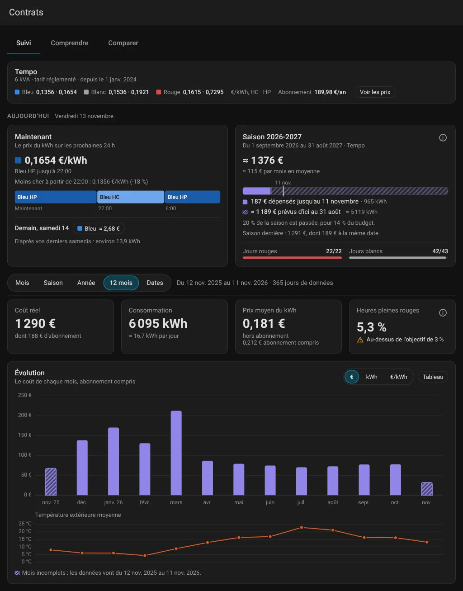
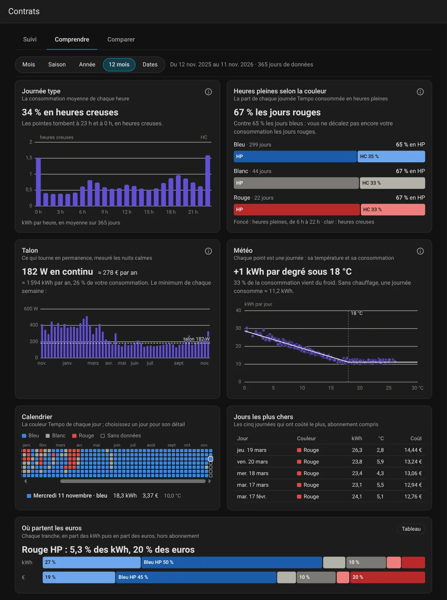
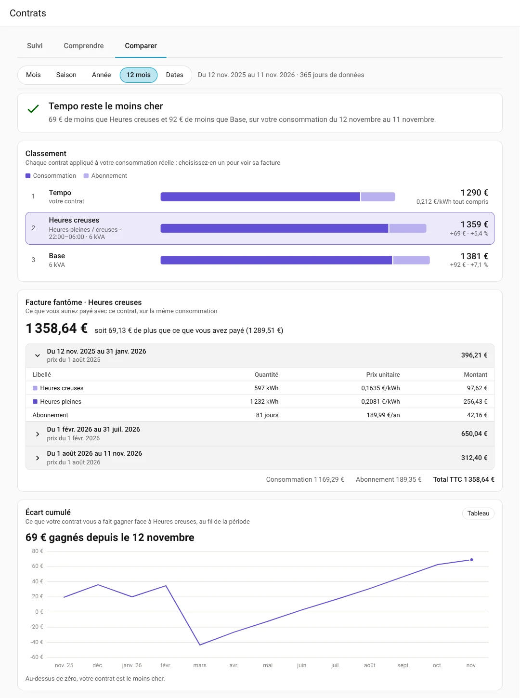
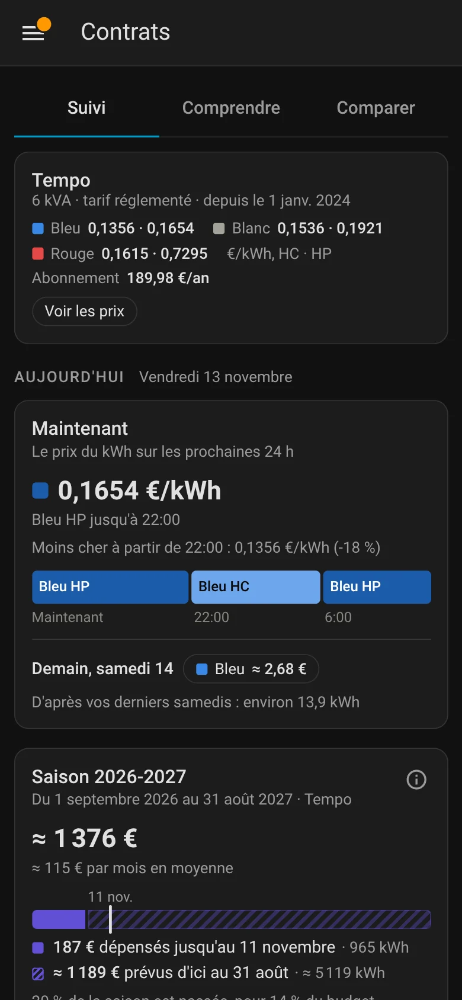

# Electricity Contracts

*[English version below](#english)*

Une intégration Home Assistant qui valorise votre consommation électrique heure par heure selon plusieurs contrats français à la fois : ce que vous payez vraiment, ce qui pèse sur la facture, et ce que vous auriez payé avec une autre offre.

- **Base**, **HP/HC** (vos plages, à la demi-heure) et **Tempo**, aux **tarifs réglementés** avec leur historique ou à **vos propres prix** ;
- le **coût réel** suit les dates de vos contrats, sur la consommation horaire déjà dans Home Assistant (par exemple la statistique de l'[App Linky](https://github.com/bokub/ha-linky)) ;
- tout se lit dans la page **Contrats** du menu latéral.



*Captures faites sur des données de démonstration.*

## Installation

1. Dans HACS, ouvrez le menu → **Dépôts personnalisés** et ajoutez `https://github.com/damou8/electricity_contracts` avec le type **Intégration**.
2. Installez **Electricity Contracts**, puis redémarrez Home Assistant.
3. Allez dans **Paramètres → Appareils et services → Ajouter une intégration → Electricity Contracts**.

Home Assistant 2026.10 ou plus récent. L'intégration a besoin du recorder.

Ensuite :
1. choisissez la statistique horaire de votre compteur ;
2. sur la page de l'intégration, **Ajouter un contrat** pour chacun de vos contrats, passés ou à comparer ;
3. ouvrez **Contrats** dans le menu latéral.

Le détail des champs et des options est dans [Configuration](docs/configuration.md).

## La page Contrats

Choisissez la période en haut de chaque onglet : mois, saison (septembre à août), année, 12 derniers mois ou dates.

- **Suivi** : le contrat en cours et ses prix, le prix du kWh maintenant et sur 24 h, ce que demain devrait coûter, le budget de la saison (avec les jours Tempo rouges et blancs restants), puis le coût réel, la consommation et le prix moyen de la période, mois par mois avec la température extérieure.
- **Comprendre** : journée type, heures pleines selon la couleur Tempo, talon, consommation selon la température, calendrier, jours les plus chers, part de chaque tranche dans les kWh et les euros.
- **Comparer** : chaque contrat appliqué à votre consommation réelle, sur les mêmes heures, du moins cher au plus cher, et la facture détaillée du contrat choisi.

| Comprendre | Comparer | Sur mobile |
| --- | --- | --- |
|  |  |  |

Le budget de la saison et le coût de demain sont des estimations, d'après vos jours passés. Rien d'estimé n'est écrit dans les statistiques.

## Capteurs

L'appareil **Contrats d'électricité** a deux capteurs, pour vos automatisations :

| Capteur | Valeur |
| --- | --- |
| Prix actuel | Le prix du kWh à cet instant selon le contrat en vigueur, hors abonnement, en €/kWh. |
| Tranche actuelle | `base`, `hp` ou `hc`, et pour Tempo la couleur avec la tranche : `blue_hc`, `white_hp`, `red_hp`… |

Ils changent à l'heure ou à la demi-heure où la tranche change. Ils sont inconnus sans contrat en vigueur, ou si la couleur Tempo du jour n'est pas connue.

Par exemple, pour couper le chauffe-eau en heures pleines rouges :

```yaml
triggers:
  - trigger: state
    entity_id: sensor.contrats_d_electricite_tranche_actuelle
    to: red_hp
actions:
  - action: switch.turn_off
    target:
      entity_id: switch.chauffe_eau
```

## Mise à niveau depuis la 0.1

Les comparaisons, leurs capteurs et les capteurs de la source (coût réel du dernier jour, prix réel du mois, contrat actuel, dernière heure de données) sont supprimés à la mise à niveau : la page Contrats les remplace. Les statistiques restent. Dans vos automatisations, utilisez les deux capteurs ci-dessus ou l'action `electricity_contracts.compare`.

## Documentation

- [Configuration](docs/configuration.md) : source, contrats, périodes de prix, options, compte RTE.
- [Statistiques et actions](docs/statistics.md) : statistiques écrites, tableau Énergie, graphiques, recalculs, action `compare`, mise à jour des données, historique quotidien.
- [Limites, dépannage et désinstallation](docs/troubleshooting.md).

## Confidentialité

La consommation ne quitte jamais Home Assistant : l'intégration ne télécharge que des tarifs et des couleurs Tempo publics. Les diagnostics masquent le numéro du compteur et les identifiants RTE.

## Licence

[MIT](LICENSE)

---

## English

A Home Assistant integration that costs your hourly electricity consumption under several French contracts at once: what you actually pay, what weighs on the bill, and what you would have paid with another offer.

- **Base**, **HP/HC** (your own ranges, to the half hour) and **Tempo**, at the **regulated prices** with their history or at **your own prices**;
- the **actual cost** follows your contracts' dates, on the hourly consumption already in Home Assistant (for example the [Linky app](https://github.com/bokub/ha-linky)'s statistic);
- it all shows on the **Contracts** page of the sidebar (screenshots above, in French, on demo data).

### Installation

1. In HACS, open the menu → **Custom repositories** and add `https://github.com/damou8/electricity_contracts` with the type **Integration**.
2. Install **Electricity Contracts**, then restart Home Assistant.
3. Go to **Settings → Devices & services → Add integration → Electricity Contracts**.

Home Assistant 2026.10 or later. The integration needs the recorder.

Then:
1. choose the hourly statistic of your meter;
2. on the integration's page, **Add contract** for each of your contracts, past ones or ones to compare;
3. open **Contracts** in the sidebar.

Every field and option is described in [Configuration](docs/configuration.md#english).

### The Contracts page

Pick the period at the top of each tab: month, season (September to August), year, last 12 months or dates.

- **Overview**: the contract in force and its prices, the price of a kWh now and over 24 hours, what tomorrow should cost, the season budget (with the red and white Tempo days left), then the period's actual cost, consumption and average price, month by month with the outdoor temperature.
- **Understand**: typical day, peak hours by Tempo color, baseload, consumption against temperature, calendar, most expensive days, each tranche's share of kWh and euros.
- **Compare**: each contract applied to your actual consumption, over the same hours, from cheapest to dearest, and the detailed bill of the chosen one.

The season budget and tomorrow's cost are estimates, from your past days. Nothing estimated is written to the statistics.

### Sensors

The **Electricity contracts** device has two sensors, for your automations:
- **Current price**: the price of a kWh right now under the contract in force, subscription excluded, in €/kWh;
- **Current tranche**: `base`, `hp` or `hc`, and for Tempo the color with the tranche: `blue_hc`, `white_hp`, `red_hp`…

They change on the hour or half hour when the tranche does. They are unknown without a contract in force, or when the day's Tempo color isn't known.

For example, to turn the water heater off during red peak hours:

```yaml
triggers:
  - trigger: state
    entity_id: sensor.electricity_contracts_current_tranche
    to: red_hp
actions:
  - action: switch.turn_off
    target:
      entity_id: switch.water_heater
```

### Upgrading from 0.1

The comparisons, their sensors and the source's sensors (actual cost of the last day, actual price this month, current contract, last hour of data) are removed by the upgrade: the Contracts page replaces them. The statistics stay. In your automations, use the two sensors above or the `electricity_contracts.compare` action.

### Documentation

- [Configuration](docs/configuration.md#english): source, contracts, price periods, options, RTE account.
- [Statistics and actions](docs/statistics.md#english): statistics written, Energy dashboard, charts, recomputing, `compare` action, data updates, daily history.
- [Limitations, troubleshooting and removal](docs/troubleshooting.md#english).

### Privacy

The consumption never leaves Home Assistant: the integration only downloads public prices and Tempo colors. Diagnostics hide the meter number and the RTE credentials.

License: [MIT](LICENSE)
